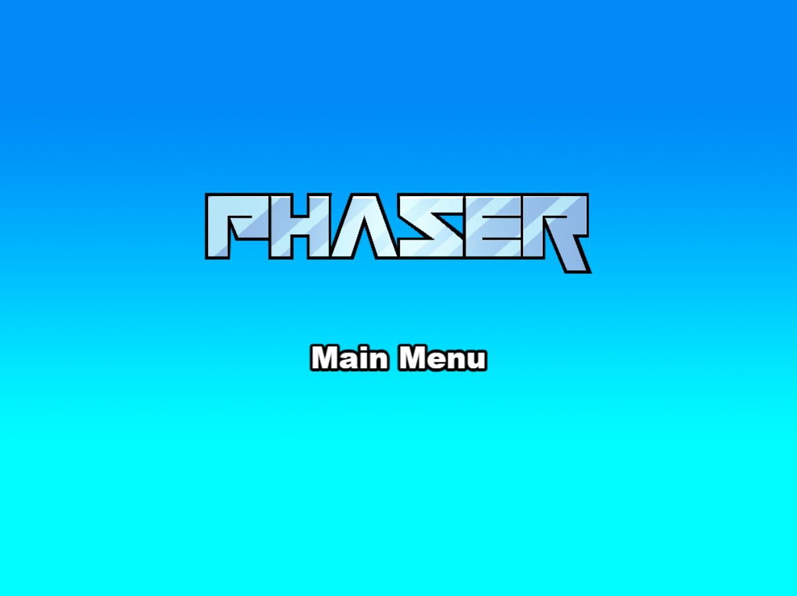

# 外卖跳一跳

扮演外卖骑手，把握时机跳上左右移动的餐盒，一层层叠高冲分。



## 玩法

1. 主菜单点击开始，倒计时 3-2-1 后开局。
2. 站稳时点击屏幕起跳（固定跳跃高度，不是长按蓄力）。
3. 落到下一个餐盒上继续叠高；落空或被移动的盒子撞到会失败。
4. 失败后进入结算，可重新挑战或返回主菜单。

## 计分

- 普通落地：**+1 米**
- 完美落在盒子中心：连击可拿到 **+2～+5 米**
- 踩到弹簧盒：整次固定 **+10 米**
- 进度条目标是 **1000 米**，到达后仍可继续往上跳

跳得越高，盒子会变得更快、更窄，难度逐渐上升。

## 道具与金币

大约每 10 个盒子会出现特殊道具：

| 道具 | 效果 |
|------|------|
| 金币盒 | 获得 20–50 金币（完美落地翻倍） |
| 护盾 | 抵挡一次撞击 |
| 弹簧 | 自动弹起，连跳多层 |
| 加速 | 后续若干个盒子移动更快 |

金币会累计保存，可在皮肤商店购买外卖盒皮肤。

## 其他内容

- **皮肤商店**：多款餐盒皮肤，用金币解锁，可多选加入随机池。
- **周排行榜**：本地周榜，对局中会提示距离上一名还差多少米。
- **福袋**：每隔一段高度出现，碰到会爆开（不加分）。
- **设置**：可调节音乐与音效。
- **好友**：入口已预留，暂未开放。

## 本地运行

```bash
npm install
npm run dev
```

浏览器打开本地地址即可游玩。打包请双击 `打包.cmd`，选择测试或生产环境。
